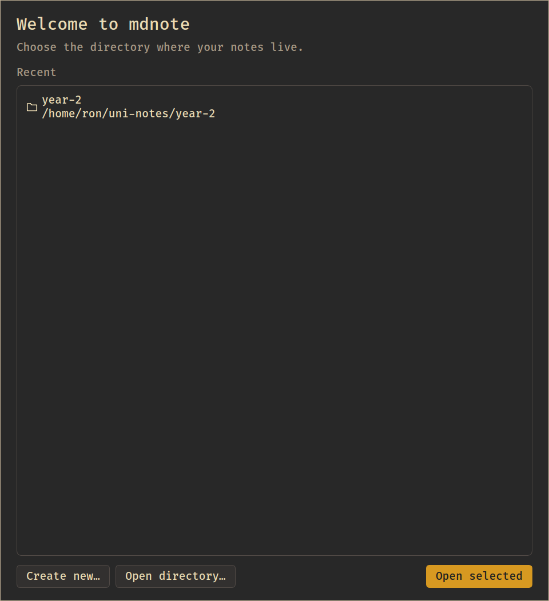
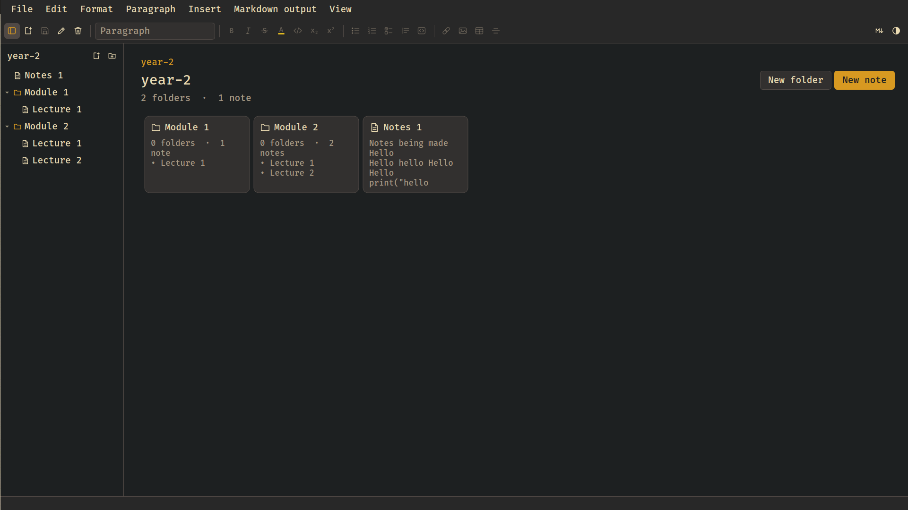
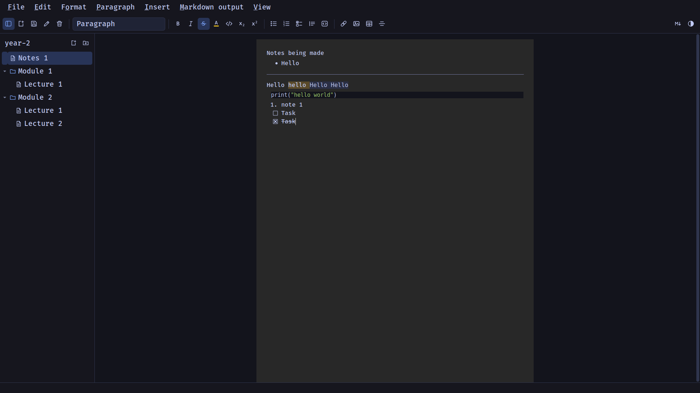
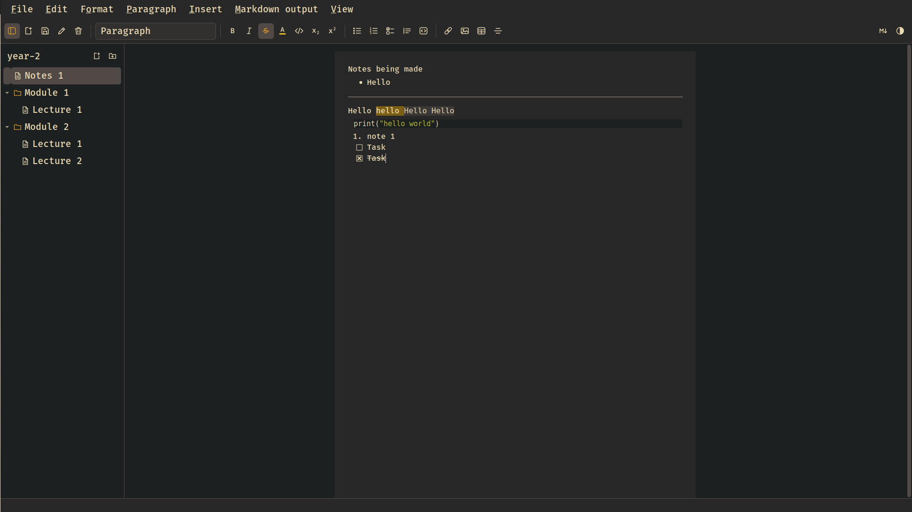
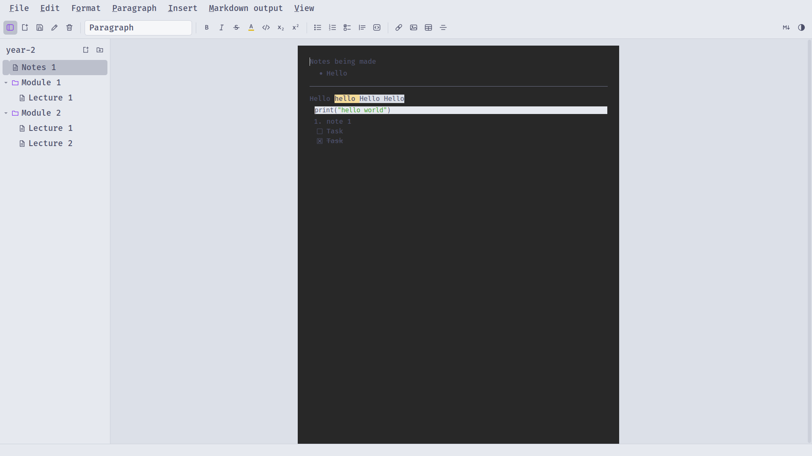
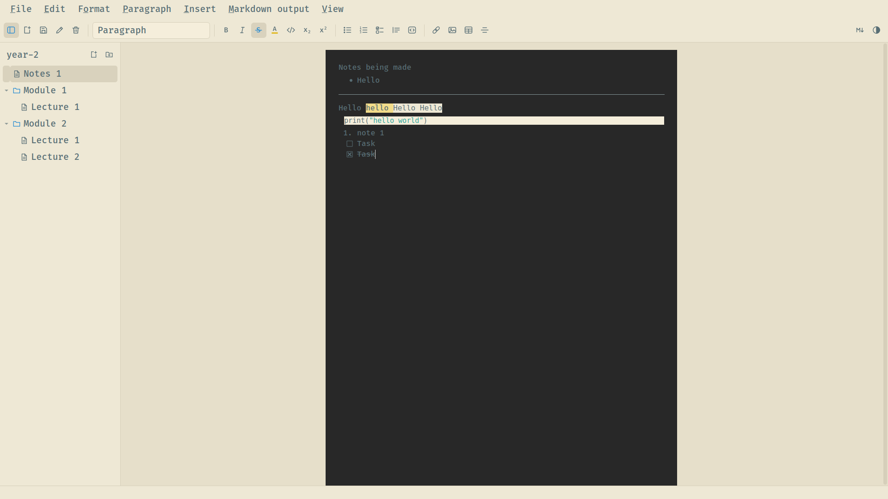

# mdnote

A WYSIWYG-style note editor that stores plain Markdown. You write in a clean, formatted view with the Markdown syntax hidden, and your notes stay as ordinary `.md` files in a directory you choose.

Built with C++17 and Qt 6.

## Screenshots

<!-- Save your screenshots in docs/screenshots/ using the file names below. -->

### Welcome screen


### Editor


### Folder preview


### Markdown source panel


### Themes
| Tokyo Night | Gruvbox Dark |
|---|---|
|  |  |

| Catppuccin Latte | Solarized Light |
|---|---|
|  |  |

## Features

- **Hidden syntax editing:** formatting is shown as you type and saved as Markdown.
- **Notes directories:** open an existing directory or create a new one at launch.
- **File explorer:** a toggleable sidebar showing folders and `.md` files.
- **Folder previews:** cards showing the contents of each folder and note.
- **File management:** create, rename and delete notes and folders.
- **Auto-save:** changes are saved shortly after you stop typing.
- **Automatic bullets:** type `- ` to start a list, and again to nest it.
- **Fixed-width page:** text wraps within a centred writing area.
- **Code blocks:** syntax highlighting for common languages.
- **Themes:** 12 light and dark colour themes.

## Requirements

| Tool | Version |
|---|---|
| C++ compiler | C++17 support (GCC, Clang) |
| CMake | 3.21 or newer |
| Qt | 6.2 or newer (Widgets, and Test for unit tests) |
| Ninja | Required by the CMake presets |

On Debian or Ubuntu:

```bash
sudo apt install build-essential cmake ninja-build qt6-base-dev
```

On Arch Linux:

```bash
sudo pacman -S base-devel cmake ninja qt6-base
```

## Building

```bash
# Release build
cmake --preset release
cmake --build --preset release
./build/release/src/mdnote

# Debug build
cmake --preset debug
cmake --build --preset debug
./build/debug/src/mdnote
```

To skip building the tests, add `-DMDNOTE_BUILD_TESTS=OFF` to the configure command.

### Running the tests

```bash
ctest --test-dir build/debug --output-on-failure
```

### Installing

```bash
cmake --install build/release --prefix ~/.local
```

This installs the `mdnote` binary and a desktop entry.

## Usage

### Getting started

1. Launch `mdnote`.
2. Choose **Create new…**, **Open directory…**, or pick a recent directory.
3. Create a note with **Ctrl+N** and start writing.

Switch to another directory at any time with **File → Switch notes directory**.

### Managing files

| Task | How |
|---|---|
| New note | Ctrl+N, the explorer button, or right-click |
| New folder | Ctrl+Shift+N, the explorer button, or right-click |
| Open | Click a note or folder in the explorer, or click its card |
| Rename | F2, the toolbar button, or right-click |
| Delete | Right-click, the toolbar button, or Delete while the explorer or cards have focus |
| Delete the open note | Ctrl+Shift+Delete |

Deleted items are moved to the system trash. If no trash is available, you are asked before anything is permanently deleted.

### Auto-save

Auto-save is on by default. A note is saved:

- about one second after you stop typing,
- when you switch to another note or folder,
- when the window loses focus,
- when you close the application.

Toggle it with **File → Auto-save**. When it is off, you are asked before unsaved changes are discarded.

### Automatic bullets

Type `- ` (dash, space) at the start of a line to create a bullet. Type it again at the start of a bullet to indent it.

| Depth | Symbol |
|---|---|
| 1 | ● Filled bullet |
| 2 | ○ Outlined bullet |
| 3 | ■ Filled square |
| 4 | □ Outlined square |

The symbols repeat for deeper levels. **Tab** and **Shift+Tab** nest and un-nest items. Press **Enter** on an empty item to move out one level. **Ctrl+Z** straight after a conversion restores the literal `- `.

### Themes

Choose a theme from **View → Theme** or the toolbar theme button. Your choice is remembered.

- Midnight (default)
- Gruvbox Dark and Gruvbox Light
- Tokyo Night, Tokyo Night Storm and Tokyo Night Day
- Catppuccin Mocha and Catppuccin Latte
- Nord
- Dracula
- Solarized Dark and Solarized Light

Changing theme clears the undo history of the open note.

## Keyboard shortcuts

### Files and view

| Shortcut | Action |
|---|---|
| Ctrl+N | New note |
| Ctrl+Shift+N | New folder |
| Ctrl+Shift+O | Switch notes directory |
| Ctrl+S | Save |
| F2 | Rename |
| Ctrl+Shift+Delete | Delete |
| Ctrl+\\ | Toggle file explorer |
| Ctrl+Q | Quit |

### Text formatting

| Shortcut | Action |
|---|---|
| Ctrl+B | Bold |
| Ctrl+I | Italic |
| Ctrl+Shift+X | Strikethrough |
| Ctrl+Shift+H | Highlight |
| Ctrl+` | Inline code |
| Ctrl+, | Subscript |
| Ctrl+. | Superscript |

### Paragraphs

| Shortcut | Action |
|---|---|
| Ctrl+0 | Plain paragraph |
| Ctrl+1 to Ctrl+6 | Heading 1 to 6 |
| Ctrl+Alt+1 / Ctrl+Alt+2 | Setext heading 1 / 2 |
| Ctrl+Alt+U | Bulleted list |
| Ctrl+Alt+O | Numbered list |
| Ctrl+Alt+T | Task list |
| Ctrl+Shift+Q / Ctrl+Alt+Q | Deeper / shallower blockquote |
| Ctrl+Shift+C | Code block |
| Ctrl+Shift+R | Horizontal rule |
| Shift+Enter | Hard line break |

### Insert

| Shortcut | Action |
|---|---|
| Ctrl+L | Link |
| Ctrl+Shift+I | Image |
| Ctrl+Shift+F | Footnote |
| Ctrl+Shift+T | Table |

Ctrl+click a link to open it.

## Supported Markdown

Headings (ATX and setext), bold, italic, strikethrough, highlight (`==text==`), subscript (`~text~`), superscript (`^text^`), inline code, fenced code blocks, blockquotes, bulleted, numbered and task lists, tables with column alignment, inline, reference and automatic links, images, footnotes, horizontal rules and hard line breaks.

Output style (emphasis marker, bullet character, line break style and list indent) is set in the **Markdown output** menu.

## Limitations

- Saving rewrites a note in mdnote's Markdown style. Formatting details or unsupported syntax (such as raw HTML) may be changed or lost. Back up important files before editing them.
- Changes made to an open note by another program are not detected, and saving will overwrite them.
- Bullet symbols come from nesting depth. They are not stored in the file.
- A nested list item with no parent item above it is moved to the top level when reopened.
- Remote (`http`) images are shown as placeholders.

## Settings

Recent directories, theme and auto-save preference are stored using Qt's `QSettings`. On Linux this is `~/.config/mdnote/mdnote.conf`.

## Project structure

```
.
├── CMakeLists.txt
├── CMakePresets.json
├── docs/screenshots/       Screenshots used in this README
├── packaging/              Desktop entry
├── src/
│   ├── main.cpp
│   ├── app/                Main window and welcome dialog
│   ├── editor/             Note editor and code highlighter
│   ├── explorer/           File explorer and folder preview
│   ├── markdown/           Markdown parser, writer and formatting
│   ├── theme/              Colour themes and application styling
│   └── ui/                 Vector icons
└── tests/                  Markdown round-trip tests
```

## License

_Add your license here._
