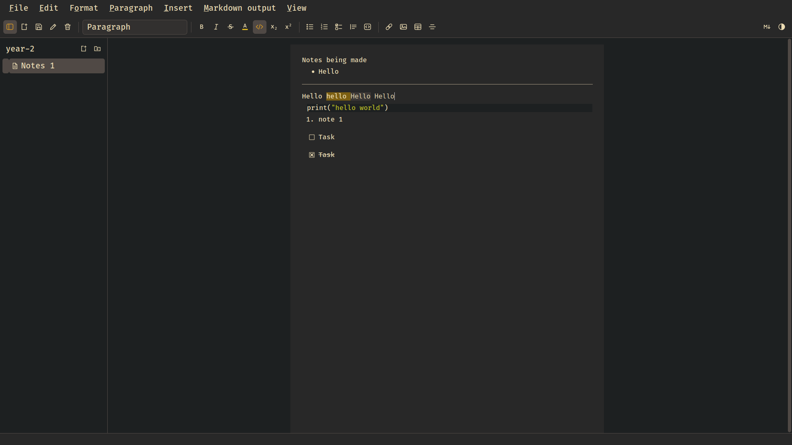
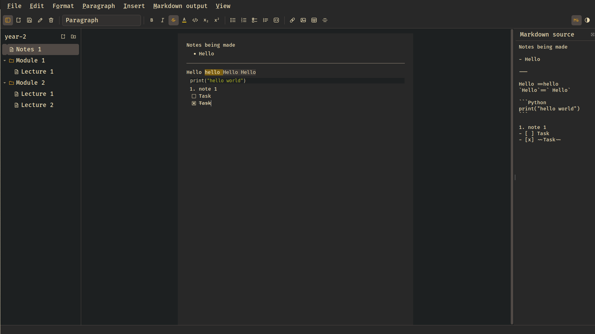

# mdnote

A WYSIWYG-style note editor that stores plain Markdown. You see formatted text while you write, and your notes stay as ordinary `.md` files in a directory you choose.

## Screenshots

<!-- Save your screenshots into docs/screenshots/ using the file names below. -->

### Welcome screen


### Editor


### Folder preview


### Markdown source panel


### Themes
| Tokyo Night | Gruvbox Dark | Solarized Light |
|---|---|---|
|  |  |  |

## Features

- **Hidden Markdown syntax:** edit formatted text directly
- **Notes directory:** open or create one at launch, with a list of recent directories
- **File explorer:** toggleable tree of folders and notes
- **Folder previews:** cards showing the contents of each folder
- **File management:** create, rename and delete notes and folders
- **Auto-save:** on by default, and can be turned off
- **Automatic bullets:** type `- ` to start a list, and again to nest it
- **Themes:** Midnight, Tokyo Night, Gruvbox Dark, Gruvbox Light, Catppuccin Mocha, Nord, Dracula and Solarized Light
- **Rich content:** headings, tables, task lists, code blocks with syntax highlighting, quotes, links, images and footnotes
- **Markdown source panel:** see exactly what will be saved

## Requirements

- A C++17 compiler
- CMake 3.21 or newer
- Qt 6.2 or newer (Widgets, plus Test for the unit tests)
- Ninja (used by the CMake presets)

On Debian or Ubuntu:

```bash
sudo apt install build-essential cmake ninja-build qt6-base-dev
```

On Arch Linux:

```bash
sudo pacman -S base-devel cmake ninja qt6-base
```

## Building and running

```bash
cmake --preset release
cmake --build --preset release
./build/release/src/mdnote
```

For a debug build, replace `release` with `debug`.

### Tests

```bash
cmake --preset debug
cmake --build --preset debug
ctest --test-dir build/debug --output-on-failure
```

To build without tests, add `-DMDNOTE_BUILD_TESTS=OFF` to the configure command.

### Installing

```bash
sudo cmake --install build/release
```

This installs the `mdnote` binary and its desktop entry.

## Usage

### Notes directory

Choose a directory when the app starts. It can contain `.md` files and subfolders, nested as deeply as you like. Other file types are hidden. Switch directories with **File → Switch notes directory**.

### Managing files

| Action | How |
|---|---|
| New note | Toolbar, `Ctrl+N`, or right-click in the explorer |
| New folder | `Ctrl+Shift+N`, or right-click in the explorer |
| Rename | Toolbar, File menu, right-click, or `F2` in the explorer or folder view |
| Delete | Toolbar, File menu, right-click, or `Delete` in the explorer or folder view |

The toolbar and File menu act on the open note, or on the folder being previewed. Deleted items go to the system trash. If the trash is unavailable, you are asked before anything is deleted permanently.

### Auto-save

Changes are saved about a second after you stop typing, when you leave a note, and when the window loses focus. Toggle this with **File → Auto-save**. With it off, you are asked before unsaved changes are discarded.

### Automatic bullets

Type `- ` at the start of a line to create a bullet. Type `- ` at the start of a bullet to indent it. The symbol depends on the depth: filled bullet, outlined bullet, filled square, outlined square. `Ctrl+Z` straight afterwards restores the typed text.

### Themes

Pick a theme from **View → Theme** or the palette button on the toolbar. Your choice is remembered.

## Keyboard shortcuts

| Shortcut | Action |
|---|---|
| `Ctrl+N` / `Ctrl+Shift+N` | New note / new folder |
| `Ctrl+Shift+O` | Switch notes directory |
| `Ctrl+S` / `Ctrl+Q` | Save / quit |
| `Ctrl+\` | Toggle file explorer |
| `Ctrl+B` / `Ctrl+I` | Bold / italic |
| `Ctrl+Shift+X` / `Ctrl+Shift+H` | Strikethrough / highlight |
| ``Ctrl+` `` | Inline code |
| `Ctrl+,` / `Ctrl+.` | Subscript / superscript |
| `Ctrl+0` to `Ctrl+6` | Paragraph / headings 1 to 6 |
| `Ctrl+Alt+1` / `Ctrl+Alt+2` | Setext headings |
| `Ctrl+Alt+U` / `O` / `T` | Bulleted / numbered / task list |
| `Tab` / `Shift+Tab` | Nest / un-nest list item, or move between table cells |
| `Ctrl+Shift+Q` / `Ctrl+Alt+Q` | Quote deeper / shallower |
| `Ctrl+Shift+C` | Code block |
| `Ctrl+Shift+R` | Horizontal rule |
| `Shift+Enter` | Hard line break |
| `Ctrl+L` | Insert link |
| `Ctrl+Shift+I` | Insert image |
| `Ctrl+Shift+F` | Insert footnote |
| `Ctrl+Shift+T` | Insert table |
| `Ctrl+Click` | Open link |

## Project structure

```
src/
├── app/        Main window and welcome dialog
├── editor/     Note editor and code highlighter
├── explorer/   File tree and folder preview
├── markdown/   Markdown parser and writer
├── theme/      Colour themes
└── ui/         Toolbar and file icons
tests/          Markdown round-trip tests
packaging/      Desktop entry
```

## Known limitations

- Saving an edited note rewrites it in mdnote's Markdown style. Unsupported syntax, such as raw HTML, may not be preserved. Keep backups or use version control for important notes.
- Changes made to the open note by another program are not detected and may be overwritten.
- A nested bullet with no parent item is flattened when the note is reopened.
- Changing the theme clears the undo history of the open note.

## License

_Add your license here._
